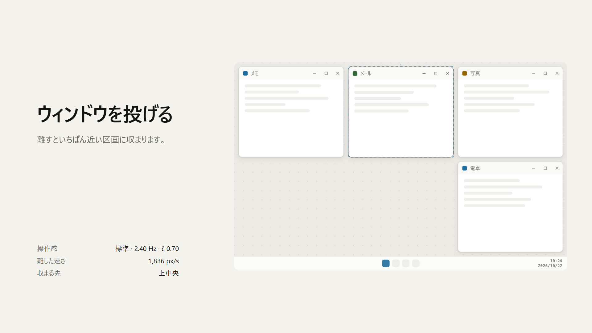
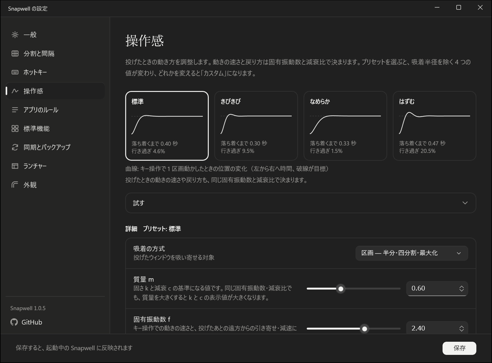
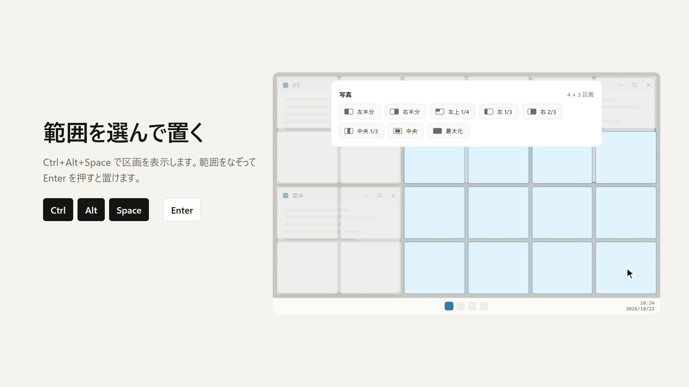
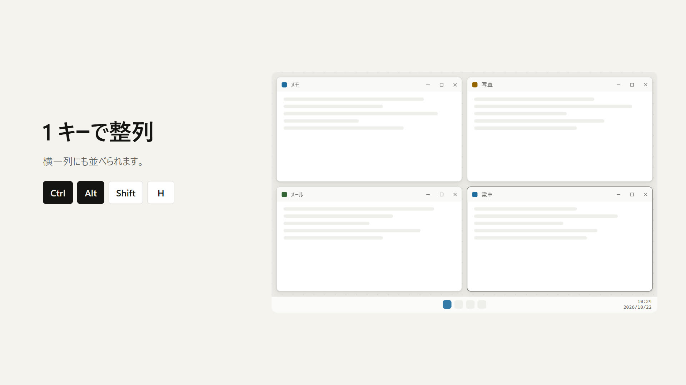
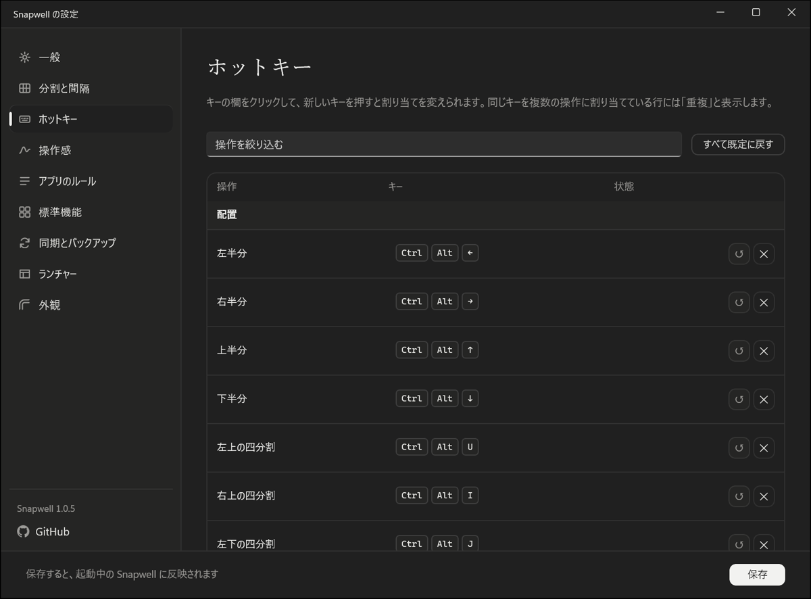

<p align="center">
  
</p>

<h1 align="center">Snapwell</h1>

<p align="center">
  <a href="README.md">English</a> | <strong>日本語</strong> | <a href="README.zh-Hans.md">简体中文</a> | <a href="README.zh-Hant.md">繁體中文</a>
</p>

Snapwell は Windows 11 用のウィンドウマネージャーです。ウィンドウを投げると、ばねと磁石の物理モデルで、いちばん近い区画に収まります。

[](https://tabunugoku.github.io/Snapwell/)

紹介動画は効果音と音楽つきです。実アプリの録画ではなく、モックアップ相当の画面を、Snapwell と同じ物理モデルで動かしたものです。[ホームページ](https://tabunugoku.github.io/Snapwell/)では投げる動きを実際に試せます。

## 特長

- 画面を 8 × 8 などのグリッドに分け、ウィンドウを区画の整数倍で配置し、サイズを変えられます。
- ウィンドウどうしの隙間と、画面端の余白をピクセルで決められます。0 にすると隙間なしで並びます。
- 離した速さから止まる位置を予測し、ばね、磁石、壁でウィンドウを区画や四隅に運びます。
- ホットキー、ランチャー、トレイのメニューで操作します。
- x64 と ARM64 のネイティブ版です。x86 は対象外です。
- 通信は、利用者が有効にした更新の確認と、「更新して再起動」を押したときの配布ファイルのダウンロード（更新用の署名で検証します）だけです。DLL を他のアプリに差し込むこともしません。

## 機能の詳細

### 投げて収める

タイトルバーをつかんで離すと、離した瞬間の速さから止まる位置を予測し、いちばん近い区画へ運びます。吸着先は区画か四隅から選べ、予測の線と収まる区画のプレビューを表示することもできます。

動きは質量、剛性、減衰から計算します。継続時間やイージング曲線は決めていません。設定画面の「操作感」で、4 つのプリセットから選ぶか、値を自分で決められます。



### 分割と間隔

分割案はモニターごとに決められ、8 × 8、12 × 6、6 × 4 などを選べます。ウィンドウの間隔と画面端の余白は 0 から 200 px の範囲で指定します。

ホットキーでは前面のウィンドウを 1 区画ずつ広げたり縮めたりできます。マウスで手動のリサイズをして離したときに、いちばん近い区画の境界へ揃える設定もあります。

「中央」のプリセットと Ctrl+Alt+C は、画面の中央にいちばん近い区画を、左右・上下対称に使います。12 × 12 のように、ちょうど中央に合わせられないグリッドでも使えます。

### ランチャー

Ctrl+Alt+Space でランチャーを開くと、対象のウィンドウがあるモニターにグリッドが重なり、区画をドラッグして選んだ範囲にウィンドウが収まります。半分、1/4、1/3、2/3、中央、最大化などのプリセットも使えます。

ランチャーからはウィンドウを最大 9 件選んで、まとめて整列することもできます。

[](https://tabunugoku.github.io/Snapwell/)

### 整列

次の 4 つの方式で、ウィンドウをまとめて並べます。

- グリッド
- 横一列
- 縦一列
- メインとスタック（前面のウィンドウを左半分に、残りを右半分に縦に並べる）

対象は現在のモニター、全モニター、ランチャーで選んだウィンドウから選べます。Ctrl+Alt+A で、現在のモニターのウィンドウをグリッドに整列します。

[](https://tabunugoku.github.io/Snapwell/)

### 隣へ寄せる、モニター間の移動

Ctrl+Alt+Shift+J、L、I、K を押すと、前面のウィンドウが左、右、上、下の隣のウィンドウの辺に、設定した間隔を空けて寄ります。Ctrl+Alt+PageUp と PageDown では、隣のモニターへ投げられます。

### ホットキー

ホットキーは設定画面のホットキーのページで、すべて変更できます。主な既定のキーは次のとおりです。

| 操作 | 既定のキー |
|---|---|
| ランチャーを開く | Ctrl+Alt+Space |
| 左、右、上、下の半分 | Ctrl+Alt+←、→、↑、↓ |
| 四分割（左上、右上、左下、右下） | Ctrl+Alt+U、I、J、K |
| 最大化 | Ctrl+Alt+Enter |
| 中央に配置 | Ctrl+Alt+C |
| 1 区画ずつ広げる、縮める | Ctrl+Alt+Shift+矢印 |
| 隣のウィンドウの辺へ寄せる（左、右、上、下） | Ctrl+Alt+Shift+J、L、I、K |
| 現在のモニターを整列（グリッド） | Ctrl+Alt+A |
| 横一列、縦一列、メインとスタックで整列 | Ctrl+Alt+Shift+H、V、M |
| 全モニターを整列 | Ctrl+Alt+Shift+A |
| 隣のモニターへ投げる | Ctrl+Alt+PageUp、PageDown |
| 一時停止と再開 | Ctrl+Alt+Pause |



### アプリごとのルール

特定のアプリのウィンドウを、Snapwell の対象から外したり、位置だけを動かしたり、ウィンドウの角の扱いを変えたりできます。ポップアップ、ゲームのランチャー、ピクチャー イン ピクチャーなど、全体の設定では扱いきれないウィンドウのためのものです。

### Windows の標準のスナップとの関係

Windows 標準のスナップ（Snap）やスナップレイアウトと動きが重なるため、設定画面で標準のスナップを止められます。Win+矢印を、左、右、上、下の半分へ置き換える設定もあります。

Snapwell が OS の設定を変えるのは、利用者が同意して設定画面でオンにしたときだけです。変更前の値は別のファイルに保存し、無効にしたとき、終了したとき、異常終了のあとの次回の起動時に元へ戻します。設定画面の「標準の動作に戻す」でも戻せます。

サインイン時の自動起動もオンにするまでは登録しません。オフにすると登録を消します。

### そのほか

- 設定は JSON のファイルで、利用者が選んだ同期フォルダー（OneDrive や Dropbox のフォルダーなど）を通して、複数の PC で共有できます。Snapwell が同期するのではなく、そのフォルダー内のファイルを読み書きします。
- 設定のインポートとエクスポートができます。
- 画面の言語は日本語、英語、中国語（簡体字・繁体字）です。中国語は 1.0.6 から使えます。既定では Windows の表示言語に合わせます。設定画面、トレイのメニュー、ランチャーは、Windows のライトテーマとダークテーマに従います。
- 初回の起動では、設定画面のセットアップが開きます。短い導入のアニメーションと、ウィンドウを投げて試せるようこそ画面のあとで、標準機能、ホットキー、分割案を順に決められます。導入はクリックか Esc で飛ばせます。Windows のアニメーション効果がオフのとき、または Snapwell の「動きを減らす」がオンのときは、自動で飛ばします。
- 操作感のページの「動きを減らす」をオンにすると、アニメーションせずに吸着先へ直接移動します。Windows の「アニメーション効果」がオフのときも同じです。
- 更新の確認は既定で無効です。自動確認を有効にしたときや「今すぐ確認」を押したときだけ GitHub Releases に問い合わせ、新しい版の案内を表示します。案内の「更新して再起動」を押すと、署名を検証した配布ファイルをダウンロードして置き換え、新しい版を起動します（押すまでダウンロードしません）。起動の確認ができない場合は、元の版へ戻します。
- 「管理者として起動」を有効にしている場合、更新後の最初の起動だけは管理者権限になりません。次にサインインしたとき、または Snapwell を終了して起動し直したときから、管理者として起動します。

## 動作環境

- Windows 11（x64 または ARM64）
- インストーラーはなく、zip を展開して使うポータブル版です。

## ダウンロードと起動

1. [Releases](https://github.com/tabunugoku/Snapwell/releases) から、PC に合う zip（`Snapwell-<版>-win-x64.zip` または `Snapwell-<版>-win-arm64.zip`）をダウンロードします。
2. 同じ場所にある `.sha256` のファイルで、zip のハッシュを確認します。PowerShell では `Get-FileHash <zip のパス> -Algorithm SHA256` を実行します。
3. zip を好きな場所に展開し、`Snapwell.exe` を実行します。トレイにアイコンが出ます。

現在配布しているビルドはコード署名がありません。そのため、Windows の SmartScreen が警告を出すことがあります。ハッシュを確認したうえで、「詳細情報」から「実行」を選んでください。署名については後述の「Code signing policy」を参照してください。

## ビルド方法

必要なものは次のとおりです。

- Windows 11
- .NET SDK 9.0.300 以降（`global.json` で指定）
- NativeAOT で publish するときは、Visual Studio の C++ ツール（x64 と ARM64 の両方）

ソリューション全体のビルドとテストは、次のとおりです。

```powershell
dotnet restore Snapwell.sln
dotnet test --no-restore
dotnet format --verify-no-changes --no-restore
```

出荷する成果物は RID（`win-x64` または `win-arm64`）を指定して、本体と設定画面を同じフォルダーに publish して作ります。ソリューションには RID を付けてビルドできないため、プロジェクトごとに実行します。

```powershell
$rid = 'win-x64'   # ARM64 は win-arm64
dotnet publish src/Snapwell.App/Snapwell.App.csproj -c Release -r $rid --no-restore -o out/$rid
dotnet publish src/Snapwell.Settings/Snapwell.Settings.csproj -c Release -r $rid --no-restore -o out/$rid
```

`out/<rid>/` の `Snapwell.exe` が本体です。同じフォルダーに `Snapwell.Settings.exe` が入ります。Git Bash では Visual Studio のツールが見つからないことがあるため、PowerShell で実行してください。

リリースは `v` から始まるタグを push すると、GitHub Actions の `release.yml` が両方の RID の zip と SHA-256 のファイルを作り、下書きのリリースに添付します。

紹介動画は `tools/film/` で作ります。作り方は [docs/RELEASE.md](docs/RELEASE.md) にあります。

## プロジェクトの構成

| フォルダー | 内容 |
|---|---|
| `src/Snapwell.Core/` | 物理モデル、グリッドと間隔の計算、整列、設定のモデル。Win32 に依存しません。 |
| `src/Snapwell.Platform/` | Win32 との接続。フック、ウィンドウの移動、モニター、DWM、標準スナップの制御。 |
| `src/Snapwell.App/` | トレイに常駐する本体。オーバーレイとランチャー。 |
| `src/Snapwell.Settings/` | 設定画面（WinUI 3）。 |
| `tests/` | xUnit の単体テスト。 |
| `docs/` | 設計、モックアップ、実機での確認の項目。 |
| `site/` | ホームページ（GitHub Pages）。 |

設計は [docs/DESIGN.md](docs/DESIGN.md)、モックアップは [docs/mockups/snapwell.html](docs/mockups/snapwell.html) にあります。リリースの手順は [docs/RELEASE.md](docs/RELEASE.md)、実機での確認は [docs/MANUAL_TEST.md](docs/MANUAL_TEST.md) にまとめています。

## Code signing policy

Free code signing provided by [SignPath.io](https://about.signpath.io/), certificate by [SignPath Foundation](https://signpath.org/).

この方針は SignPath Foundation の無償のコード署名を申請するためのものです。署名の承認を得るまで、配布しているビルドは署名されていません。承認を得たあとのリリースから、次の方針で署名します。更新の前に Snapwell が確認する更新用の署名は、このコード署名とは別の仕組みです。

- 署名するのは、リリースの zip に入る `Snapwell.exe` と `Snapwell.Settings.exe` です。Microsoft など第三者のコンポーネントは、署名し直しません。
- 署名は、このリポジトリのタグが付いたコミットから、GitHub Actions の `release.yml` が作ったビルドにだけ付けます。手元でビルドしたものには付けません。
- リリースごとに、承認者が署名の依頼を手動で承認します。
- 製品名とバージョンは、署名するすべてのファイルのメタデータで一致させます。
- 役割は次のとおりです。現在のメンテナーは 1 人で、すべての役割を兼ねます。

| 役割 | 担当 |
|---|---|
| コミッターとレビュー担当 | [tabunugoku](https://github.com/tabunugoku) |
| 承認者 | [tabunugoku](https://github.com/tabunugoku) |

- リポジトリの変更は、メンテナーがレビューしてからマージします。署名に関わる GitHub と SignPath のアカウントは、多要素認証で守ります。
- 署名のないビルドや、署名の問題の報告は、[Issues](https://github.com/tabunugoku/Snapwell/issues) で受け付けます。

## プライバシーポリシー

This program will not transfer any information to other networked systems unless specifically requested by the user or the person installing or operating it.

Snapwell は既定ではどこにも通信しません。解析、トラッキング、アカウント、それ以外の自動送信は行いません。利用者が「更新を自動で確認する」を有効にしたときや「今すぐ確認」を押したときだけ、GitHub Releases へ GET 要求を送って更新を確認します。送信するのは GET 要求と User-Agent（`Snapwell/<版>`）だけで、識別子や利用状況は送信しません（接続先の GitHub には IP アドレスが見えます）。「更新して再起動」を押したときだけ、配布ファイルを GitHub からダウンロードし、更新用の署名で検証します（GET と User-Agent のみ）。設定は次のファイルに、この PC の中だけで保存します。

- `%APPDATA%\Snapwell\`（設定）
- `%LOCALAPPDATA%\Snapwell\`（この PC の状態と、OS の設定の退避値）

設定を同期するには、利用者が同期フォルダーを選びます。Snapwell はそのフォルダー内のファイルを読み書きするだけです。ファイルをクラウドに送るのは、利用者が選んだ OneDrive や Dropbox などのサービスです。

## ライセンス

Snapwell は [MIT ライセンス](LICENSE)で公開しています。動きの物理モデルは [feel](https://github.com/diip3sh/feel)（MIT）のアルゴリズムを移植したものです。著作権表示は [THIRD_PARTY_NOTICES.md](THIRD_PARTY_NOTICES.md) にあります。
