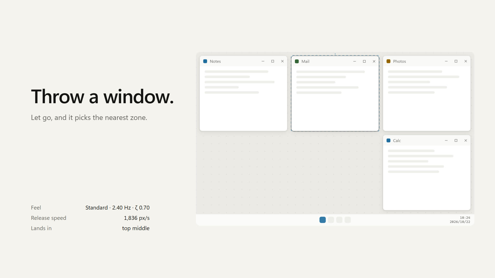
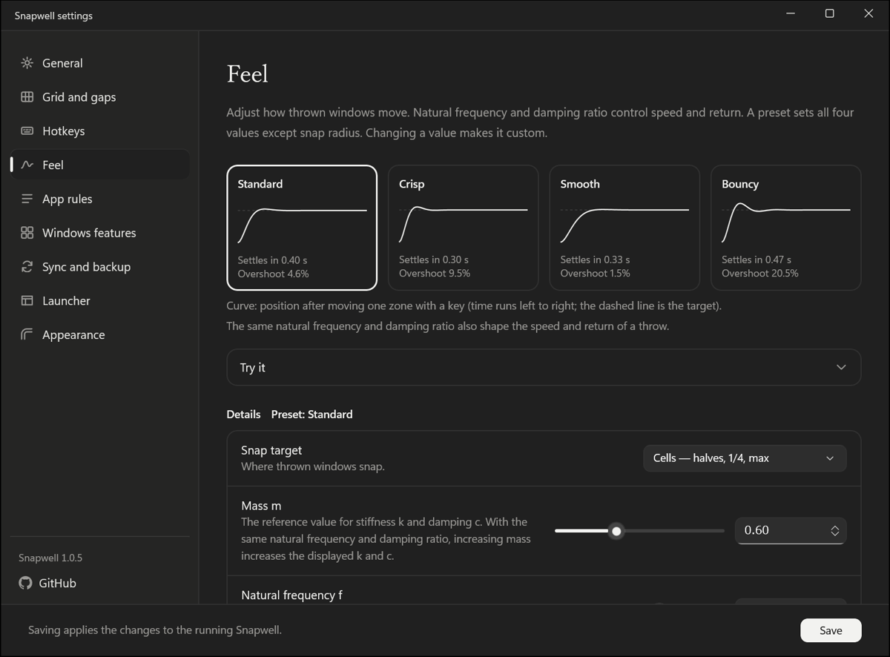
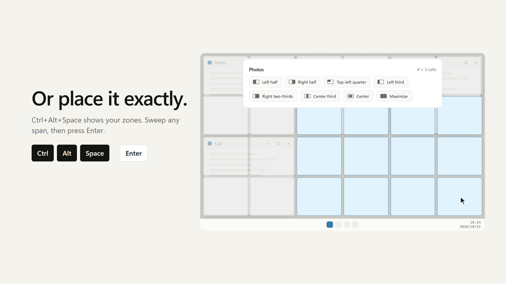
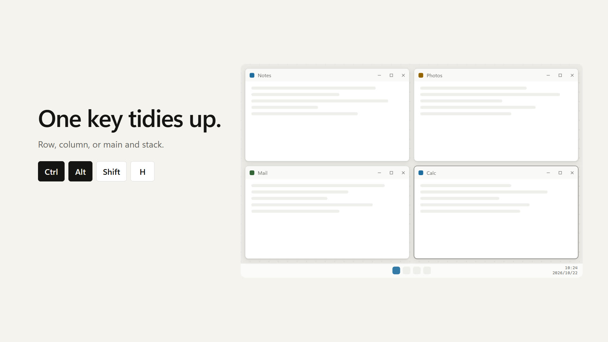
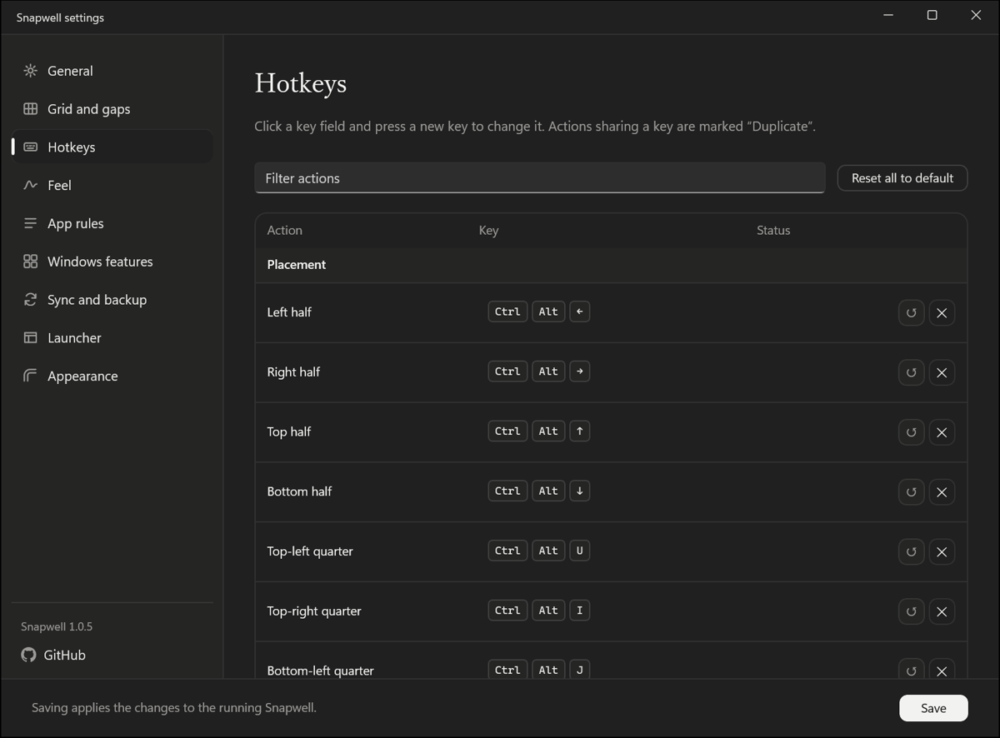

<p align="center">
  
</p>

<h1 align="center">Snapwell</h1>

<p align="center">
  <strong>English</strong> | <a href="README.ja.md">日本語</a> | <a href="README.zh-Hans.md">简体中文</a> | <a href="README.zh-Hant.md">繁體中文</a>
</p>

Snapwell is a window manager for Windows 11. Throw a window, and a spring and a magnet pull it into the nearest zone of your grid.

[](https://tabunugoku.github.io/Snapwell/)

The film has sound effects and music. It is not a screen recording of the app. It shows a mockup of the interface, driven by the same physics model as Snapwell. On the [home page](https://tabunugoku.github.io/Snapwell/) you can throw a window yourself.

## Highlights

- Divide the screen into a grid such as 8 × 8, then place and resize windows in whole zones.
- Set the gap between windows and the margin at the screen edge in pixels. A gap of 0 packs windows flush.
- From the speed you let go with, Snapwell predicts where a window would stop, then carries it to a zone or a corner with a spring, a magnet and walls.
- Work with hotkeys, a launcher and a tray menu.
- Native on x64 and ARM64. There is no x86 build.
- Network access is limited to the optional update check and, only when you click "Update and restart", the download of the signed release package. No DLL is injected into other apps.

## Features in detail

### Throw to snap

Grab a title bar and let go. Snapwell reads the speed at release, predicts where the window would stop, and carries it to the nearest zone. You can snap to zones or to corners, and you can show the prediction line and a preview of the zone the window will land in.

Motion is computed from mass, stiffness and damping. No durations or easing curves are fixed. On the Feel page of the settings window, pick one of four presets or set the values yourself.



### Grid and gaps

You choose a grid for each monitor, such as 8 × 8, 12 × 6 or 6 × 4. The gap between windows and the margin at the screen edge can each be set from 0 to 200 px.

Hotkeys grow or shrink the front window one zone at a time. An option also snaps a window to the nearest zone boundary when you release it after resizing by hand.

The Center preset and Ctrl+Alt+C use the zones nearest the middle of the screen, symmetrically. This also works on grids that cannot hit the middle exactly, such as 12 × 12.

### Launcher

Ctrl+Alt+Space opens the launcher. A grid appears over the monitor that holds the target window, and the window fits the range of zones you drag across. Presets are also available: halves, quarters, thirds, two-thirds, center and maximize, among others.

From the launcher you can also select up to nine windows and arrange them together.

[](https://tabunugoku.github.io/Snapwell/)

### Arrange

Snapwell arranges windows in one of four layouts.

- Grid
- Row
- Column
- Main and stack (the front window on the left half, the others stacked down the right half)

The target can be the current monitor, all monitors, or the windows you picked in the launcher. Ctrl+Alt+A arranges the windows on the current monitor in a grid.

[](https://tabunugoku.github.io/Snapwell/)

### Snap to a neighbor, move between monitors

Ctrl+Alt+Shift+J, L, I and K move the front window against the edge of the neighboring window on its left, right, top or bottom, leaving the gap you set. Ctrl+Alt+PageUp and PageDown throw it to the next monitor.

### Hotkeys

Every hotkey can be changed on the Hotkeys page of the settings window. The main defaults are:

| Action | Default key |
|---|---|
| Open the launcher | Ctrl+Alt+Space |
| Left, right, top, bottom half | Ctrl+Alt+←, →, ↑, ↓ |
| Quarters (top left, top right, bottom left, bottom right) | Ctrl+Alt+U, I, J, K |
| Maximize | Ctrl+Alt+Enter |
| Center | Ctrl+Alt+C |
| Grow or shrink by one zone | Ctrl+Alt+Shift+arrow |
| Move against a neighbor's edge (left, right, top, bottom) | Ctrl+Alt+Shift+J, L, I, K |
| Arrange the current monitor (grid) | Ctrl+Alt+A |
| Arrange as a row, a column, or main and stack | Ctrl+Alt+Shift+H, V, M |
| Arrange all monitors | Ctrl+Alt+Shift+A |
| Throw to the next monitor | Ctrl+Alt+PageUp, PageDown |
| Pause and resume | Ctrl+Alt+Pause |



### Per-app rules

For a particular app's windows, you can leave them out of Snapwell, move only their position, or change how their corners are handled. The rules are for windows that the global settings cannot handle, such as pop-ups, game launchers and picture-in-picture.

### Windows' own snapping

Windows' built-in Snap and snap layouts overlap with Snapwell's motion, so the settings window can turn the built-in snapping off. Another option replaces Win+arrow with left, right, top and bottom halves.

Snapwell changes an OS setting only when you agree and switch it on in the settings window. It saves the original value in a separate file and restores it when you turn the option off, when Snapwell quits, and at the next start after a crash. The Restore standard behavior button in the settings window does the same.

Starting at sign-in is also not registered until you turn it on. Turning it off removes the registration.

### More

- Settings are a JSON file, and you can share them across PCs through a sync folder of your choice, such as a OneDrive or Dropbox folder. Snapwell does not do the syncing. It reads and writes the file in that folder.
- You can import and export settings.
- The interface is available in Japanese, English and Chinese (Simplified and Traditional; Chinese from version 1.0.6), and follows the Windows display language by default. The settings window, tray menu and launcher follow the Windows light or dark theme.
- On first launch, a setup in the settings window opens with a short intro animation and a welcome screen where you can throw a window. Then you decide the standard features, hotkeys and grid in turn. Click or press Esc to skip the intro. It is skipped on its own when Windows animation effects are off or Snapwell's reduce motion option is on.
- The Feel page has an option to reduce motion. When it is on, or when Windows animation effects are off, windows move straight to their destination without animation.
- By default, Snapwell does not check for updates. When you turn on automatic checks or click Check now, it checks GitHub Releases for new versions. Clicking Update and restart in the notice downloads the signed release package, verifies it, replaces the files and starts the new version. Nothing is downloaded until you click, and if the new version cannot be confirmed to start, Snapwell rolls back to the previous one.
- If you turned on Start as administrator, the first launch after an update does not run as administrator. It does from the next sign-in, or after you quit Snapwell and start it again.

## Requirements

- Windows 11 (x64 or ARM64)
- There is no installer. Snapwell is a portable build that you unpack from a zip.

## Download and run

1. From [Releases](https://github.com/tabunugoku/Snapwell/releases), download the zip that matches your PC: `Snapwell-<version>-win-x64.zip` or `Snapwell-<version>-win-arm64.zip`.
2. Check the zip's hash against the `.sha256` file beside it. In PowerShell, run `Get-FileHash <path to the zip> -Algorithm SHA256`.
3. Unpack the zip anywhere and run `Snapwell.exe`. An icon appears in the tray.

The builds distributed now are not code-signed, so Windows SmartScreen may show a warning. After checking the hash, choose More info, then Run anyway. For signing, see the Code signing policy below.

## Build from source

You need:

- Windows 11
- .NET SDK 9.0.300 or later (set in `global.json`)
- For a NativeAOT publish, the Visual Studio C++ tools for both x64 and ARM64

To restore, test and check formatting for the whole solution:

```powershell
dotnet restore Snapwell.sln
dotnet test --no-restore
dotnet format --verify-no-changes --no-restore
```

The shipped artifacts are published per RID (`win-x64` or `win-arm64`), with the app and the settings window going into the same folder. A solution cannot be built with a RID, so run it per project:

```powershell
$rid = 'win-x64'   # use win-arm64 for ARM64
dotnet publish src/Snapwell.App/Snapwell.App.csproj -c Release -r $rid --no-restore -o out/$rid
dotnet publish src/Snapwell.Settings/Snapwell.Settings.csproj -c Release -r $rid --no-restore -o out/$rid
```

`Snapwell.exe` in `out/<rid>/` is the app, and `Snapwell.Settings.exe` lands in the same folder. Git Bash may not find the Visual Studio tools, so run the commands in PowerShell.

When you push a tag that starts with `v`, the `release.yml` workflow on GitHub Actions builds a zip and a SHA-256 file for both RIDs and attaches them to a draft release.

The film is built in `tools/film/`. See [docs/RELEASE.md](docs/RELEASE.md) for how.

## Project layout

| Folder | Contents |
|---|---|
| `src/Snapwell.Core/` | Physics model, grid and gap math, arrangement, settings model. No Win32 dependency. |
| `src/Snapwell.Platform/` | The Win32 layer: hooks, window moves, monitors, DWM, control of standard snapping. |
| `src/Snapwell.App/` | The tray-resident app, overlay and launcher. |
| `src/Snapwell.Settings/` | The settings window (WinUI 3). |
| `tests/` | xUnit unit tests. |
| `docs/` | Design, mockups, and items to check on real devices. |
| `site/` | The home page (GitHub Pages). |

The design is in [docs/DESIGN.md](docs/DESIGN.md) and the mockup is [docs/mockups/snapwell.html](docs/mockups/snapwell.html). The release steps are in [docs/RELEASE.md](docs/RELEASE.md), and the checks on real devices are in [docs/MANUAL_TEST.md](docs/MANUAL_TEST.md).

## Code signing policy

Free code signing provided by [SignPath.io](https://about.signpath.io/), certificate by [SignPath Foundation](https://signpath.org/).

This policy is written to apply for free code signing from SignPath Foundation. Until the application is approved, the builds we distribute are not signed. From the first release after approval, we sign under the following policy.

- We sign `Snapwell.exe` and `Snapwell.Settings.exe`, which go into the release zip. Third-party components, such as Microsoft's, are not re-signed.
- Only builds made by the `release.yml` workflow on GitHub Actions, from a tagged commit of this repository, are signed. Builds made on a local machine are never signed.
- For each release, an approver manually approves the signing request.
- The product name and version in the metadata match across every signed file.
- The roles are listed below. There is currently a single maintainer, who holds all of them.

| Role | Assigned to |
|---|---|
| Committer and reviewer | [tabunugoku](https://github.com/tabunugoku) |
| Approver | [tabunugoku](https://github.com/tabunugoku) |

- The maintainer reviews changes to the repository before merging them. The GitHub and SignPath accounts involved in signing are protected with multi-factor authentication.
- Report an unsigned build or a signing problem in [Issues](https://github.com/tabunugoku/Snapwell/issues).

## Privacy policy

This program will not transfer any information to other networked systems unless specifically requested by the user or the person installing or operating it.

By default, Snapwell makes no network connections. It does no analytics or tracking, has no accounts, and sends nothing else automatically. Only when you turn on automatic update checks or click Check now does it send a GET request to GitHub Releases for update information. It sends only the GET request and a User-Agent header (`Snapwell/<version>`), with no identifiers or usage data (GitHub can see your IP address). Only when you click Update and restart does Snapwell download a signed release package from GitHub (GET and User-Agent only). Snapwell stores settings only on this PC, in these folders:

- `%APPDATA%\Snapwell\` (settings)
- `%LOCALAPPDATA%\Snapwell\` (the state of this PC, and the saved original values of OS settings)

To sync settings, you pick a sync folder. Snapwell only reads and writes the file in that folder. The service you chose, such as OneDrive or Dropbox, is what sends the file to the cloud.

## License

Snapwell is released under the [MIT License](LICENSE). The physics model of the motion is a port of the algorithm from [feel](https://github.com/diip3sh/feel) (MIT). The copyright notice is in [THIRD_PARTY_NOTICES.md](THIRD_PARTY_NOTICES.md).
