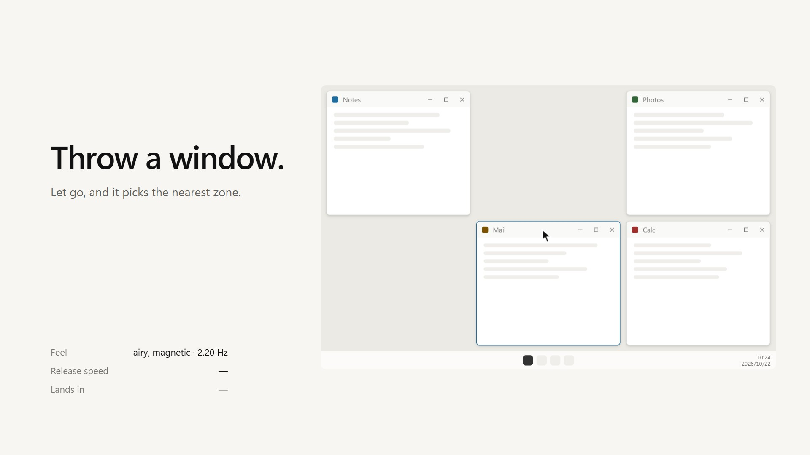
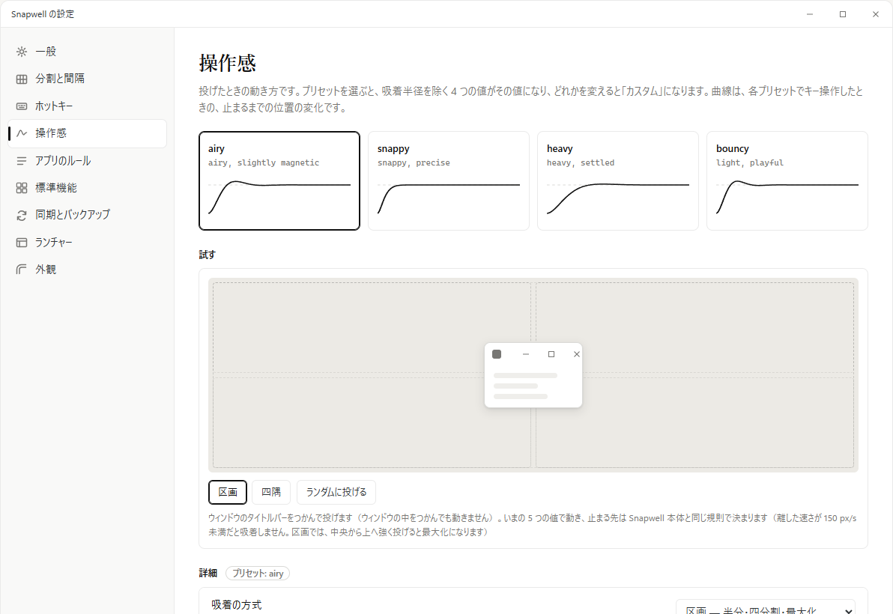
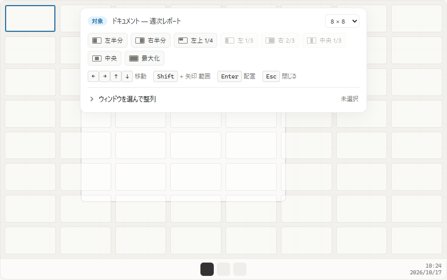
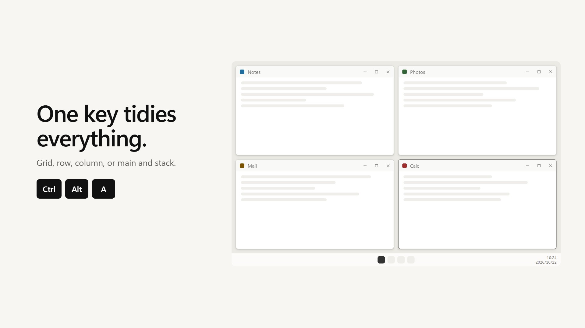
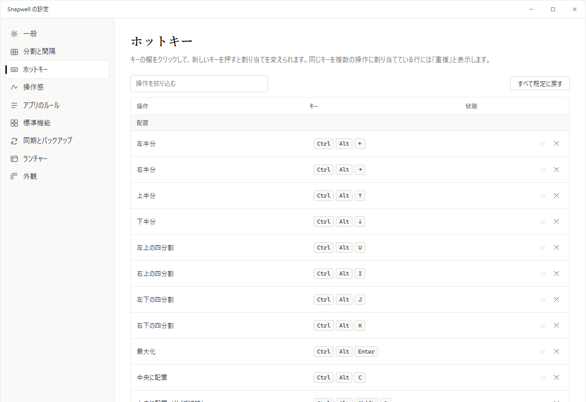

<p align="center">
  
</p>

<h1 align="center">Snapwell</h1>

Snapwell is a window manager for Windows 11. Throw a window, and a spring and a magnet pull it into the nearest zone of your grid.

[](https://tabunugoku.github.io/Snapwell/)

The film is not a screen recording of the app. It shows a mockup of the interface, driven by the same physics model as Snapwell. On the [home page](https://tabunugoku.github.io/Snapwell/) you can throw a window yourself.

The Japanese original of this page is folded at the bottom. 日本語の原文は、末尾の折りたたみにあります。

## Highlights

- Divide the screen into a grid such as 8 × 8, then place and resize windows in whole zones.
- Set the gap between windows and the margin at the screen edge in pixels. A gap of 0 packs windows flush.
- From the speed you let go with, Snapwell predicts where a window would stop, then carries it to a zone or a corner with a spring, a magnet and walls.
- Work with hotkeys, a launcher and a tray menu.
- Native on x64 and ARM64. There is no x86 build.
- No network access, and no DLL is injected into other apps.

## Features in detail

### Throw to snap

Grab a title bar and let go. Snapwell reads the speed at release, predicts where the window would stop, and carries it to the nearest zone. You can snap to zones or to corners, and you can show the prediction line and a preview of the zone the window will land in.

Motion is computed from mass, stiffness and damping. No durations or easing curves are fixed. On the Feel page of the settings window, pick one of four presets or set the values yourself.



### Grid and gaps

You choose a grid for each monitor, such as 8 × 8, 12 × 6 or 6 × 4. The gap between windows and the margin at the screen edge can each be set from 0 to 200 px.

Hotkeys grow or shrink the front window one zone at a time. An option also snaps a window to the nearest zone boundary when you release it after resizing by hand.

### Launcher

Ctrl+Alt+Space opens the launcher. A grid appears over the monitor that holds the target window, and the window fits the range of zones you drag across. Presets are also available: halves, quarters, thirds, two-thirds, center and maximize, among others.

From the launcher you can also select up to nine windows and arrange them together.



### Arrange

Snapwell arranges windows in one of four layouts.

- Grid
- Row
- Column
- Main and stack (the front window on the left half, the others stacked down the right half)

The target can be the current monitor, all monitors, or the windows you picked in the launcher. Ctrl+Alt+A arranges the windows on the current monitor in a grid.

[](https://tabunugoku.github.io/Snapwell/)

### Snap to a neighbor, move between monitors

Ctrl+Alt+Shift+J, L, I and K move the front window against the edge of the neighboring window on its left, right, top or bottom, leaving the gap you set. Ctrl+Alt+PageUp and PageDown throw it to the next monitor.

### Hotkeys

Every hotkey can be changed on the Hotkeys page of the settings window. The main defaults are:

| Action | Default key |
|---|---|
| Open the launcher | Ctrl+Alt+Space |
| Left, right, top, bottom half | Ctrl+Alt+←, →, ↑, ↓ |
| Quarters (top left, top right, bottom left, bottom right) | Ctrl+Alt+U, I, J, K |
| Maximize | Ctrl+Alt+Enter |
| Center | Ctrl+Alt+C |
| Grow or shrink by one zone | Ctrl+Alt+Shift+arrow |
| Move against a neighbor's edge (left, right, top, bottom) | Ctrl+Alt+Shift+J, L, I, K |
| Arrange the current monitor (grid) | Ctrl+Alt+A |
| Arrange as a row, a column, or main and stack | Ctrl+Alt+Shift+H, V, M |
| Arrange all monitors | Ctrl+Alt+Shift+A |
| Throw to the next monitor | Ctrl+Alt+PageUp, PageDown |
| Pause and resume | Ctrl+Alt+Pause |



### Per-app rules

For a particular app's windows, you can leave them out of Snapwell, move only their position, or change how their corners are handled. The rules are for windows that the global settings cannot handle, such as pop-ups, game launchers and picture-in-picture.

### Windows' own snapping

Windows' built-in Snap and snap layouts overlap with Snapwell's motion, so the settings window can turn the built-in snapping off. Another option replaces Win+arrow with left, right, top and bottom halves.

Snapwell changes an OS setting only when you agree and switch it on in the settings window. It saves the original value in a separate file and restores it when you turn the option off, when Snapwell quits, and at the next start after a crash. The Restore standard behavior button in the settings window does the same.

Starting at sign-in is also not registered until you turn it on. Turning it off removes the registration.

### More

- Settings are a JSON file, and you can share them across PCs through a sync folder of your choice, such as a OneDrive or Dropbox folder. Snapwell does not do the syncing. It reads and writes the file in that folder.
- You can import and export settings.
- The interface is available in Japanese and English, and follows the Windows display language by default.
- On first launch, a setup in the settings window lets you decide the standard features, hotkeys and grid in turn.

## Requirements

- Windows 11 (x64 or ARM64)
- There is no installer. Snapwell is a portable build that you unpack from a zip.

## Download and run

1. From [Releases](https://github.com/tabunugoku/Snapwell/releases), download the zip that matches your PC: `Snapwell-<version>-win-x64.zip` or `Snapwell-<version>-win-arm64.zip`.
2. Check the zip's hash against the `.sha256` file beside it. In PowerShell, run `Get-FileHash <path to the zip> -Algorithm SHA256`.
3. Unpack the zip anywhere and run `Snapwell.exe`. An icon appears in the tray.

The builds distributed now are not code-signed, so Windows SmartScreen may show a warning. After checking the hash, choose More info, then Run anyway. For signing, see the Code signing policy below.

## Build from source

You need:

- Windows 11
- .NET SDK 9.0.300 or later (set in `global.json`)
- For a NativeAOT publish, the Visual Studio C++ tools for both x64 and ARM64

To restore, test and check formatting for the whole solution:

```powershell
dotnet restore Snapwell.sln
dotnet test --no-restore
dotnet format --verify-no-changes --no-restore
```

The shipped artifacts are published per RID (`win-x64` or `win-arm64`), with the app and the settings window going into the same folder. A solution cannot be built with a RID, so run it per project:

```powershell
$rid = 'win-x64'   # use win-arm64 for ARM64
dotnet publish src/Snapwell.App/Snapwell.App.csproj -c Release -r $rid --no-restore -o out/$rid
dotnet publish src/Snapwell.Settings/Snapwell.Settings.csproj -c Release -r $rid --no-restore -o out/$rid
```

`Snapwell.exe` in `out/<rid>/` is the app, and `Snapwell.Settings.exe` lands in the same folder. Git Bash may not find the Visual Studio tools, so run the commands in PowerShell.

When you push a tag that starts with `v`, the `release.yml` workflow on GitHub Actions builds a zip and a SHA-256 file for both RIDs and attaches them to a draft release.

The film is built in `tools/film/`. See [docs/RELEASE.md](docs/RELEASE.md) for how.

## Project layout

| Folder | Contents |
|---|---|
| `src/Snapwell.Core/` | Physics model, grid and gap math, arrangement, settings model. No Win32 dependency. |
| `src/Snapwell.Platform/` | The Win32 layer: hooks, window moves, monitors, DWM, control of standard snapping. |
| `src/Snapwell.App/` | The tray-resident app, overlay and launcher. |
| `src/Snapwell.Settings/` | The settings window (WinUI 3). |
| `tests/` | xUnit unit tests. |
| `docs/` | Design, mockups, and items to check on real devices. |
| `site/` | The home page (GitHub Pages). |

The design is in [docs/DESIGN.md](docs/DESIGN.md) and the mockup is [docs/mockups/snapwell.html](docs/mockups/snapwell.html). The release steps are in [docs/RELEASE.md](docs/RELEASE.md), and the checks on real devices are in [docs/MANUAL_TEST.md](docs/MANUAL_TEST.md).

## Code signing policy

Free code signing provided by [SignPath.io](https://about.signpath.io/), certificate by [SignPath Foundation](https://signpath.org/).

This policy is written to apply for free code signing from SignPath Foundation. Until the application is approved, the builds we distribute are not signed. From the first release after approval, we sign under the following policy.

- We sign `Snapwell.exe` and `Snapwell.Settings.exe`, which go into the release zip. Third-party components, such as Microsoft's, are not re-signed.
- Only builds made by the `release.yml` workflow on GitHub Actions, from a tagged commit of this repository, are signed. Builds made on a local machine are never signed.
- For each release, an approver manually approves the signing request.
- The product name and version in the metadata match across every signed file.
- The roles are listed below. There is currently a single maintainer, who holds all of them.

| Role | Assigned to |
|---|---|
| Committer and reviewer | [tabunugoku](https://github.com/tabunugoku) |
| Approver | [tabunugoku](https://github.com/tabunugoku) |

- The maintainer reviews changes to the repository before merging them. The GitHub and SignPath accounts involved in signing are protected with multi-factor authentication.
- Report an unsigned build or a signing problem in [Issues](https://github.com/tabunugoku/Snapwell/issues).

## Privacy policy

This program will not transfer any information to other networked systems unless specifically requested by the user or the person installing or operating it.

Snapwell does no analytics or tracking, has no accounts, and does not check for updates or send anything automatically. It stores settings only on this PC, in these folders:

- `%APPDATA%\Snapwell\` (settings)
- `%LOCALAPPDATA%\Snapwell\` (the state of this PC, and the saved original values of OS settings)

To sync settings, you pick a sync folder. Snapwell only reads and writes the file in that folder. The service you chose, such as OneDrive or Dropbox, is what sends the file to the cloud.

## License

Snapwell is released under the [MIT License](LICENSE). The physics model of the motion is a port of the algorithm from [feel](https://github.com/diip3sh/feel) (MIT). The copyright notice is in [THIRD_PARTY_NOTICES.md](THIRD_PARTY_NOTICES.md).

---

<details>
<summary>日本語（原文）</summary>

Snapwell は Windows 11 用のウィンドウマネージャーです。ウィンドウを投げると、ばねと磁石の物理モデルで、いちばん近い区画に収まります。

[](https://tabunugoku.github.io/Snapwell/)

紹介動画は実アプリの録画ではなく、モックアップ相当の画面を、Snapwell と同じ物理モデルで動かしたものです。[ホームページ](https://tabunugoku.github.io/Snapwell/)では投げる動きを実際に試せます。

## 特長

- 画面を 8 × 8 などのグリッドに分け、ウィンドウを区画の整数倍で配置し、サイズを変えられます。
- ウィンドウどうしの隙間と、画面端の余白をピクセルで決められます。0 にすると隙間なしで並びます。
- 離した速さから止まる位置を予測し、ばね、磁石、壁でウィンドウを区画や四隅に運びます。
- ホットキー、ランチャー、トレイのメニューで操作します。
- x64 と ARM64 のネイティブ版です。x86 は対象外です。
- ネットワークにはつながず、DLL を他のアプリに差し込むこともしません。

## 機能の詳細

### 投げて収める

タイトルバーをつかんで離すと、離した瞬間の速さから止まる位置を予測し、いちばん近い区画へ運びます。吸着先は区画か四隅から選べ、予測の線と収まる区画のプレビューを表示することもできます。

動きは質量、剛性、減衰から計算します。継続時間やイージング曲線は決めていません。設定画面の「操作感」で、4 つのプリセットから選ぶか、値を自分で決められます。


### 分割と間隔

分割案はモニターごとに決められ、8 × 8、12 × 6、6 × 4 などを選べます。ウィンドウの間隔と画面端の余白は 0 から 200 px の範囲で指定します。

ホットキーでは前面のウィンドウを 1 区画ずつ広げたり縮めたりできます。マウスで手動のリサイズをして離したときに、いちばん近い区画の境界へ揃える設定もあります。

### ランチャー

Ctrl+Alt+Space でランチャーを開くと、対象のウィンドウがあるモニターにグリッドが重なり、区画をドラッグして選んだ範囲にウィンドウが収まります。半分、1/4、1/3、2/3、中央、最大化などのプリセットも使えます。

ランチャーからはウィンドウを最大 9 件選んで、まとめて整列することもできます。


### 整列

次の 4 つの方式で、ウィンドウをまとめて並べます。

- グリッド
- 横一列
- 縦一列
- メインとスタック（前面のウィンドウを左半分に、残りを右半分に縦に並べる）

対象は現在のモニター、全モニター、ランチャーで選んだウィンドウから選べます。Ctrl+Alt+A で、現在のモニターのウィンドウをグリッドに整列します。

[](https://tabunugoku.github.io/Snapwell/)

### 隣へ寄せる、モニター間の移動

Ctrl+Alt+Shift+J、L、I、K を押すと、前面のウィンドウが左、右、上、下の隣のウィンドウの辺に、設定した間隔を空けて寄ります。Ctrl+Alt+PageUp と PageDown では、隣のモニターへ投げられます。

### ホットキー

ホットキーは設定画面のホットキーのページで、すべて変更できます。主な既定のキーは次のとおりです。

| 操作 | 既定のキー |
|---|---|
| ランチャーを開く | Ctrl+Alt+Space |
| 左、右、上、下の半分 | Ctrl+Alt+←、→、↑、↓ |
| 四分割（左上、右上、左下、右下） | Ctrl+Alt+U、I、J、K |
| 最大化 | Ctrl+Alt+Enter |
| 中央に配置 | Ctrl+Alt+C |
| 1 区画ずつ広げる、縮める | Ctrl+Alt+Shift+矢印 |
| 隣のウィンドウの辺へ寄せる（左、右、上、下） | Ctrl+Alt+Shift+J、L、I、K |
| 現在のモニターを整列（グリッド） | Ctrl+Alt+A |
| 横一列、縦一列、メインとスタックで整列 | Ctrl+Alt+Shift+H、V、M |
| 全モニターを整列 | Ctrl+Alt+Shift+A |
| 隣のモニターへ投げる | Ctrl+Alt+PageUp、PageDown |
| 一時停止と再開 | Ctrl+Alt+Pause |


### アプリごとのルール

特定のアプリのウィンドウを、Snapwell の対象から外したり、位置だけを動かしたり、ウィンドウの角の扱いを変えたりできます。ポップアップ、ゲームのランチャー、ピクチャー イン ピクチャーなど、全体の設定では扱いきれないウィンドウのためのものです。

### Windows の標準のスナップとの関係

Windows 標準のスナップ（Snap）やスナップレイアウトと動きが重なるため、設定画面で標準のスナップを止められます。Win+矢印を、左、右、上、下の半分へ置き換える設定もあります。

Snapwell が OS の設定を変えるのは、利用者が同意して設定画面でオンにしたときだけです。変更前の値は別のファイルに保存し、無効にしたとき、終了したとき、異常終了のあとの次回の起動時に元へ戻します。設定画面の「標準の動作に戻す」でも戻せます。

サインイン時の自動起動もオンにするまでは登録しません。オフにすると登録を消します。

### そのほか

- 設定は JSON のファイルで、利用者が選んだ同期フォルダー（OneDrive や Dropbox のフォルダーなど）を通して、複数の PC で共有できます。Snapwell が同期するのではなく、そのフォルダー内のファイルを読み書きします。
- 設定のインポートとエクスポートができます。
- 画面の言語は日本語と英語です。既定では Windows の表示言語に合わせます。
- 初回の起動では、設定画面のセットアップが開き、標準機能、ホットキー、分割案を順に決められます。

## 動作環境

- Windows 11（x64 または ARM64）
- インストーラーはなく、zip を展開して使うポータブル版です。

## ダウンロードと起動

1. [Releases](https://github.com/tabunugoku/Snapwell/releases) から、PC に合う zip（`Snapwell-<版>-win-x64.zip` または `Snapwell-<版>-win-arm64.zip`）をダウンロードします。
2. 同じ場所にある `.sha256` のファイルで、zip のハッシュを確認します。PowerShell では `Get-FileHash <zip のパス> -Algorithm SHA256` を実行します。
3. zip を好きな場所に展開し、`Snapwell.exe` を実行します。トレイにアイコンが出ます。

現在配布しているビルドはコード署名がありません。そのため、Windows の SmartScreen が警告を出すことがあります。ハッシュを確認したうえで、「詳細情報」から「実行」を選んでください。署名については後述の「Code signing policy」を参照してください。

## ビルド方法

必要なものは次のとおりです。

- Windows 11
- .NET SDK 9.0.300 以降（`global.json` で指定）
- NativeAOT で publish するときは、Visual Studio の C++ ツール（x64 と ARM64 の両方）

ソリューション全体のビルドとテストは、次のとおりです。

```powershell
dotnet restore Snapwell.sln
dotnet test --no-restore
dotnet format --verify-no-changes --no-restore
```

出荷する成果物は RID（`win-x64` または `win-arm64`）を指定して、本体と設定画面を同じフォルダーに publish して作ります。ソリューションには RID を付けてビルドできないため、プロジェクトごとに実行します。

```powershell
$rid = 'win-x64'   # ARM64 は win-arm64
dotnet publish src/Snapwell.App/Snapwell.App.csproj -c Release -r $rid --no-restore -o out/$rid
dotnet publish src/Snapwell.Settings/Snapwell.Settings.csproj -c Release -r $rid --no-restore -o out/$rid
```

`out/<rid>/` の `Snapwell.exe` が本体です。同じフォルダーに `Snapwell.Settings.exe` が入ります。Git Bash では Visual Studio のツールが見つからないことがあるため、PowerShell で実行してください。

リリースは `v` から始まるタグを push すると、GitHub Actions の `release.yml` が両方の RID の zip と SHA-256 のファイルを作り、下書きのリリースに添付します。

紹介動画は `tools/film/` で作ります。作り方は [docs/RELEASE.md](docs/RELEASE.md) にあります。

## プロジェクトの構成

| フォルダー | 内容 |
|---|---|
| `src/Snapwell.Core/` | 物理モデル、グリッドと間隔の計算、整列、設定のモデル。Win32 に依存しません。 |
| `src/Snapwell.Platform/` | Win32 との接続。フック、ウィンドウの移動、モニター、DWM、標準スナップの制御。 |
| `src/Snapwell.App/` | トレイに常駐する本体。オーバーレイとランチャー。 |
| `src/Snapwell.Settings/` | 設定画面（WinUI 3）。 |
| `tests/` | xUnit の単体テスト。 |
| `docs/` | 設計、モックアップ、実機での確認の項目。 |
| `site/` | ホームページ（GitHub Pages）。 |

設計は [docs/DESIGN.md](docs/DESIGN.md)、モックアップは [docs/mockups/snapwell.html](docs/mockups/snapwell.html) にあります。リリースの手順は [docs/RELEASE.md](docs/RELEASE.md)、実機での確認は [docs/MANUAL_TEST.md](docs/MANUAL_TEST.md) にまとめています。

## Code signing policy

Free code signing provided by [SignPath.io](https://about.signpath.io/), certificate by [SignPath Foundation](https://signpath.org/).

この方針は SignPath Foundation の無償のコード署名を申請するためのものです。署名の承認を得るまで、配布しているビルドは署名されていません。承認を得たあとのリリースから、次の方針で署名します。

- 署名するのは、リリースの zip に入る `Snapwell.exe` と `Snapwell.Settings.exe` です。Microsoft など第三者のコンポーネントは、署名し直しません。
- 署名は、このリポジトリのタグが付いたコミットから、GitHub Actions の `release.yml` が作ったビルドにだけ付けます。手元でビルドしたものには付けません。
- リリースごとに、承認者が署名の依頼を手動で承認します。
- 製品名とバージョンは、署名するすべてのファイルのメタデータで一致させます。
- 役割は次のとおりです。現在のメンテナーは 1 人で、すべての役割を兼ねます。

| 役割 | 担当 |
|---|---|
| コミッターとレビュー担当 | [tabunugoku](https://github.com/tabunugoku) |
| 承認者 | [tabunugoku](https://github.com/tabunugoku) |

- リポジトリの変更は、メンテナーがレビューしてからマージします。署名に関わる GitHub と SignPath のアカウントは、多要素認証で守ります。
- 署名のないビルドや、署名の問題の報告は、[Issues](https://github.com/tabunugoku/Snapwell/issues) で受け付けます。

## プライバシーポリシー

This program will not transfer any information to other networked systems unless specifically requested by the user or the person installing or operating it.

Snapwell は解析、トラッキング、アカウント、更新の確認、自動送信をしません。設定は次のファイルに、この PC の中だけで保存します。

- `%APPDATA%\Snapwell\`（設定）
- `%LOCALAPPDATA%\Snapwell\`（この PC の状態と、OS の設定の退避値）

設定を同期するには、利用者が同期フォルダーを選びます。Snapwell はそのフォルダー内のファイルを読み書きするだけです。ファイルをクラウドに送るのは、利用者が選んだ OneDrive や Dropbox などのサービスです。

## ライセンス

Snapwell は [MIT ライセンス](LICENSE)で公開しています。動きの物理モデルは [feel](https://github.com/diip3sh/feel)（MIT）のアルゴリズムを移植したものです。著作権表示は [THIRD_PARTY_NOTICES.md](THIRD_PARTY_NOTICES.md) にあります。

</details>
