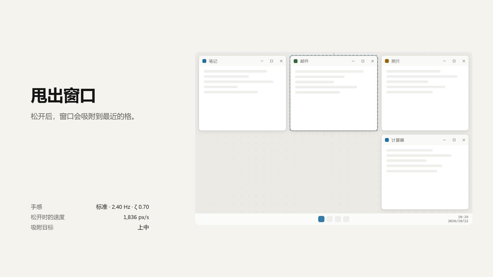
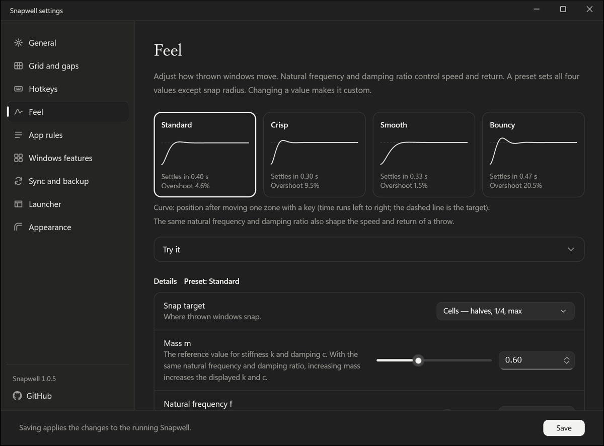
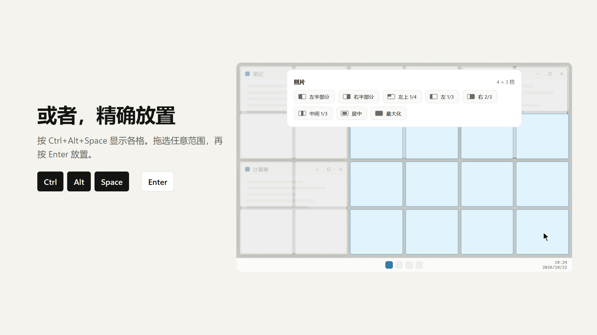
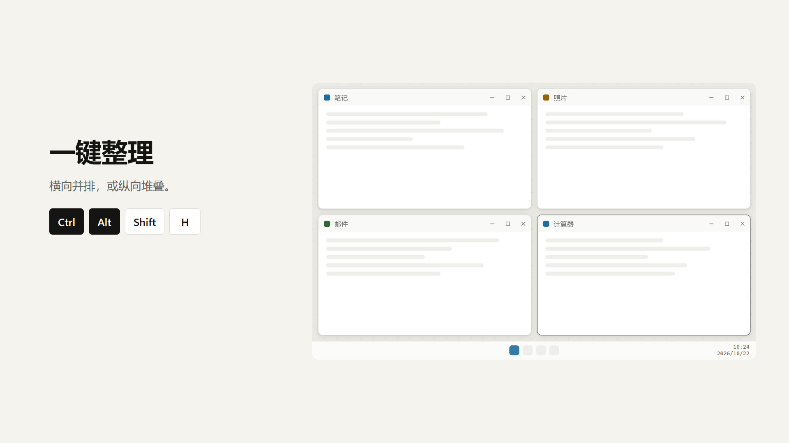
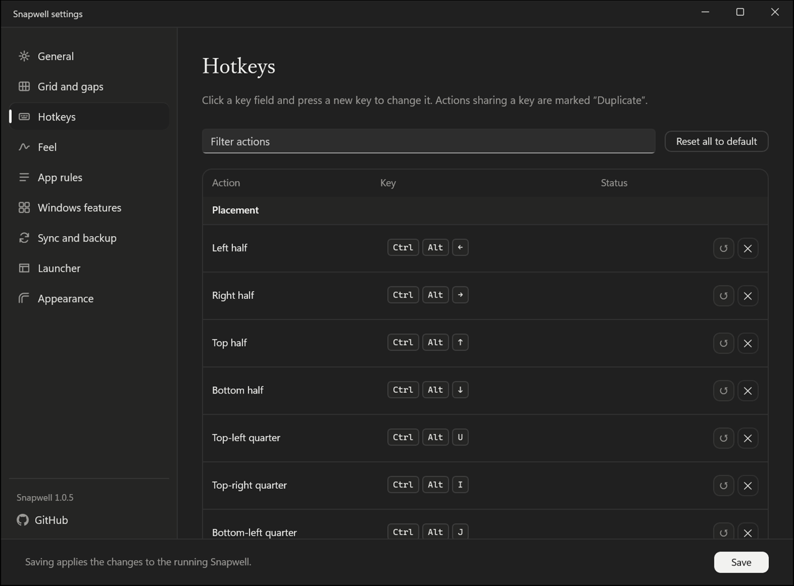

<p align="center">
  
</p>

<h1 align="center">Snapwell</h1>

<p align="center">
  <a href="README.md">English</a> | <a href="README.ja.md">日本語</a> | <strong>简体中文</strong> | <a href="README.zh-Hant.md">繁體中文</a>
</p>

Snapwell 是一款适用于 Windows 11 的窗口管理器。把窗口甩出去，弹簧与磁铁会把它拉向网格中最近的格。

[](https://tabunugoku.github.io/Snapwell/)

视频配有音效和音乐。它不是应用的屏幕录制，而是用与 Snapwell 相同的物理模型驱动的界面模型（mockup）。在[主页](https://tabunugoku.github.io/Snapwell/)上，您可以亲自甩一甩窗口。

## 特点

- 将屏幕划分为网格（例如 8 × 8），以整格为单位放置窗口并调整大小。
- 以像素为单位设置窗口之间的间距和屏幕边缘的边距。间距为 0 时，窗口紧挨排列。
- 根据松开时的速度预测窗口会停在哪里，再借助弹簧、磁铁和墙壁，把窗口送到某个格或屏幕四角。
- 可通过快捷键、启动器和托盘菜单操作。
- 提供 x64 和 ARM64 原生版本，没有 x86 版本。
- 网络访问仅限于可选的更新检查，以及您单击“更新并重启”时下载发布包（用更新签名验证）。不会向其他应用注入 DLL。

## 功能详解

### 甩出即吸附

抓住标题栏后松开。Snapwell 会根据松开瞬间的速度预测窗口会停在哪里，并把它送到最近的格。吸附目标可以选择格或四角，也可以显示预测线和“目标区域预览”（窗口将落入的格）。

运动由质量、刚度和阻尼计算得出，没有固定的时长或缓动曲线。在设置窗口的“手感”页中，可以从 4 个预设里选择，也可以自行设置各项数值。



### 网格与间距

可以为每台显示器分别选择网格，例如 8 × 8、12 × 6 或 6 × 4。窗口间距和屏幕边缘的边距都可以在 0 到 200 px 之间设置。

可以用快捷键将前台窗口每次扩大或缩小一格。还有一个选项：手动调整大小后松开时，窗口会吸附到最近的格边界。

“居中”预设和 Ctrl+Alt+C 会左右、上下对称地使用最靠近屏幕中央的格。对于 12 × 12 这类无法恰好对准中央的网格也同样适用。

### 启动器

按 Ctrl+Alt+Space 打开启动器。目标窗口所在的显示器上会叠加出网格，窗口会贴合您拖选出的格范围。也可以使用预设，例如二分之一、四分之一、三分之一、三分之二、居中和最大化等。

在启动器中还可以最多选择 9 个窗口，一并排列。

[](https://tabunugoku.github.io/Snapwell/)

### 排列

Snapwell 提供 4 种排列方式。

- 网格
- 横向并排
- 纵向堆叠
- 主窗口与堆叠（前台窗口占左半边，其余窗口纵向堆叠在右半边）

排列对象可以是当前显示器、所有显示器，或在启动器中选择的窗口。按 Ctrl+Alt+A，可将当前显示器上的窗口按网格排列。

[](https://tabunugoku.github.io/Snapwell/)

### 靠向相邻窗口、在显示器之间移动

按 Ctrl+Alt+Shift+J、L、I、K，前台窗口会靠向其左侧、右侧、上方或下方相邻窗口的边缘，并保留您设置的间距。按 Ctrl+Alt+PageUp 和 PageDown，可把窗口甩到相邻的显示器。

### 快捷键

所有快捷键都可以在设置窗口的“快捷键”页中更改。主要的默认按键如下。

| 操作 | 默认按键 |
|---|---|
| 打开启动器 | Ctrl+Alt+Space |
| 左、右、上、下半边 | Ctrl+Alt+←、→、↑、↓ |
| 四分之一（左上、右上、左下、右下） | Ctrl+Alt+U、I、J、K |
| 最大化 | Ctrl+Alt+Enter |
| 居中 | Ctrl+Alt+C |
| 每次扩大或缩小一格 | Ctrl+Alt+Shift+方向键 |
| 靠向相邻窗口的边缘（左、右、上、下） | Ctrl+Alt+Shift+J、L、I、K |
| 排列当前显示器（网格） | Ctrl+Alt+A |
| 横向并排、纵向堆叠、主窗口与堆叠 | Ctrl+Alt+Shift+H、V、M |
| 排列所有显示器 | Ctrl+Alt+Shift+A |
| 甩到下一个显示器 | Ctrl+Alt+PageUp、PageDown |
| 暂停／恢复 | Ctrl+Alt+Pause |



### 应用规则

对于特定应用的窗口，可以将其排除在 Snapwell 之外、只移动位置，或更改圆角的处理方式。这些规则适用于全局设置难以处理的窗口，例如弹出窗口、游戏启动器和画中画。

### Windows 自带的贴靠

Windows 内置的贴靠和贴靠布局会与 Snapwell 的窗口移动相互冲突，因此可以在设置窗口中关闭内置贴靠。另一个选项可将 Win + 方向键改为执行 Snapwell 的左、右、上、下半边操作。

只有在您同意并在设置窗口中开启该选项后，Snapwell 才会更改 Windows 设置。更改前的原始值会保存在单独的文件中，并在您关闭该选项时、Snapwell 退出时，以及崩溃后下次启动时恢复。设置窗口中的“恢复 Windows 行为”按钮也能实现同样的效果。

“登录时启动”同样在您开启之前不会注册，关闭后会移除注册。

### 其他

- 设置是一个 JSON 文件，可以通过您自选的同步文件夹（例如 OneDrive 或 Dropbox 文件夹）在多台电脑间共享。同步不由 Snapwell 完成，它只是读写该文件夹中的文件。
- 支持导入和导出设置。
- 界面语言有日语、英语和中文（简体、繁体）。中文自 1.0.6 起提供。默认跟随 Windows 的显示语言。设置窗口、托盘菜单和启动器会跟随 Windows 的浅色或深色主题。
- 首次启动时会打开设置窗口中的初始设置：先播放一段简短的开场动画，再进入可以甩窗口试玩的欢迎界面，然后依次决定 Windows 功能、快捷键和网格。单击或按 Esc 可跳过开场动画。当 Windows 的动画效果关闭，或 Snapwell 的“减少动画”选项开启时，会自动跳过。
- “手感”页提供“减少动画”选项。开启后，或 Windows 的动画效果处于关闭状态时，窗口会不带动画地直接移到目标位置。
- 默认不检查更新。只有在您开启“自动检查更新”，或单击“立即检查”时，才会向 GitHub Releases 查询新版本。在通知中单击“更新并重启”后，会下载发布包、用更新签名验证、替换文件并启动新版本。在您单击之前不会下载任何内容；如果无法确认新版本能正常启动，Snapwell 会回滚到之前的版本。
- 如果您开启了“以管理员身份启动”，更新后的第一次启动不会以管理员身份运行。从下次登录起，或退出 Snapwell 后重新启动时，才会以管理员身份运行。

## 运行环境

- Windows 11（x64 或 ARM64）
- 没有安装程序。这是解压 zip 后即可使用的便携版。

## 下载与运行

1. 从 [Releases](https://github.com/tabunugoku/Snapwell/releases) 下载与您的电脑匹配的 zip：`Snapwell-<版本>-win-x64.zip` 或 `Snapwell-<版本>-win-arm64.zip`。
2. 将 zip 的校验和与旁边的 `.sha256` 文件核对。在 PowerShell 中运行 `Get-FileHash <zip 的路径> -Algorithm SHA256`。
3. 将 zip 解压到任意位置，运行 `Snapwell.exe`。托盘中会出现图标。

目前发布的版本未经代码签名，因此 Windows SmartScreen 可能会显示警告。核对校验和后，请选择“更多信息”，然后选择“仍要运行”。关于签名，请参阅下文的 Code signing policy。

## 从源代码构建

需要：

- Windows 11
- .NET SDK 9.0.300 或更高版本（在 `global.json` 中指定）
- 若要进行 NativeAOT 发布，需要 Visual Studio 的 C++ 工具（x64 和 ARM64 都要）

还原整个解决方案、运行测试并检查格式：

```powershell
dotnet restore Snapwell.sln
dotnet test --no-restore
dotnet format --verify-no-changes --no-restore
```

要发布的产物按 RID（`win-x64` 或 `win-arm64`）发布，应用和设置窗口会放入同一个文件夹。解决方案无法带 RID 构建，因此请按项目分别运行：

```powershell
$rid = 'win-x64'   # ARM64 请用 win-arm64
dotnet publish src/Snapwell.App/Snapwell.App.csproj -c Release -r $rid --no-restore -o out/$rid
dotnet publish src/Snapwell.Settings/Snapwell.Settings.csproj -c Release -r $rid --no-restore -o out/$rid
```

`out/<rid>/` 中的 `Snapwell.exe` 是应用本体，`Snapwell.Settings.exe` 会放在同一个文件夹。Git Bash 可能找不到 Visual Studio 的工具，请在 PowerShell 中运行这些命令。

推送以 `v` 开头的标签后，GitHub Actions 上的 `release.yml` 工作流会为两个 RID 构建 zip 和 SHA-256 文件，并附加到草稿发布中。

视频在 `tools/film/` 中制作，制作方法见 [docs/RELEASE.md](docs/RELEASE.md)。

## 项目结构

| 文件夹 | 内容 |
|---|---|
| `src/Snapwell.Core/` | 物理模型、网格与间距的计算、排列、设置模型。不依赖 Win32。 |
| `src/Snapwell.Platform/` | Win32 层：钩子、窗口移动、显示器、DWM、对 Windows 自带贴靠的控制。 |
| `src/Snapwell.App/` | 常驻托盘的应用本体、叠加层和启动器。 |
| `src/Snapwell.Settings/` | 设置窗口（WinUI 3）。 |
| `tests/` | xUnit 单元测试。 |
| `docs/` | 设计、界面模型（mockup）以及需要在真机上检查的事项。 |
| `site/` | 主页（GitHub Pages）。 |

设计见 [docs/DESIGN.md](docs/DESIGN.md)，界面模型是 [docs/mockups/snapwell.html](docs/mockups/snapwell.html)。发布步骤见 [docs/RELEASE.md](docs/RELEASE.md)，真机检查见 [docs/MANUAL_TEST.md](docs/MANUAL_TEST.md)。

## Code signing policy

Free code signing provided by [SignPath.io](https://about.signpath.io/), certificate by [SignPath Foundation](https://signpath.org/).

本政策是为向 SignPath Foundation 申请免费代码签名而撰写的。在申请获批之前，我们分发的版本不带签名。从获批后的第一个版本起，我们将按以下政策签名。Snapwell 在更新前检查的更新签名，与此处的代码签名是两套不同的机制。

- 我们签名的是放入发布 zip 的 `Snapwell.exe` 和 `Snapwell.Settings.exe`。Microsoft 等第三方组件不会重新签名。
- 只有由 GitHub Actions 上的 `release.yml` 工作流，基于本仓库带标签的提交所构建的版本才会签名。在本地构建的版本绝不签名。
- 每次发布，都由批准人手动批准签名请求。
- 所有已签名文件的元数据中，产品名称和版本保持一致。
- 角色如下。目前只有一名维护者，兼任所有角色。

| 角色 | 负责人 |
|---|---|
| 提交者与审阅者 | [tabunugoku](https://github.com/tabunugoku) |
| 批准人 | [tabunugoku](https://github.com/tabunugoku) |

- 对仓库的更改，由维护者审阅后再合并。与签名相关的 GitHub 和 SignPath 账户均使用多重身份验证加以保护。
- 如发现未签名的版本或签名问题，请在 [Issues](https://github.com/tabunugoku/Snapwell/issues) 中报告。

## 隐私政策

This program will not transfer any information to other networked systems unless specifically requested by the user or the person installing or operating it.

Snapwell 默认不建立任何网络连接。它不做分析或跟踪，没有账户，也不会自动发送其他任何内容。只有在您开启“自动检查更新”，或单击“立即检查”时，它才会向 GitHub Releases 发送 GET 请求以获取更新信息。发送的只有 GET 请求和 User-Agent 标头（`Snapwell/<版本>`），不含标识符或使用数据（GitHub 能看到您的 IP 地址）。只有在您单击“更新并重启”时，Snapwell 才会从 GitHub 下载发布包（仅有 GET 和 User-Agent），并用更新签名验证。设置仅保存在此电脑上的以下文件夹中：

- `%APPDATA%\Snapwell\`（设置）
- `%LOCALAPPDATA%\Snapwell\`（此电脑的状态，以及已保存的 Windows 设置原始值）

要同步设置，需由您选择同步文件夹。Snapwell 只读写该文件夹中的文件。把文件发送到云端的，是您所选的服务，例如 OneDrive 或 Dropbox。

## 许可证

Snapwell 以 [MIT 许可证](LICENSE)发布。运动的物理模型移植自 [feel](https://github.com/diip3sh/feel)（MIT）的算法。版权声明见 [THIRD_PARTY_NOTICES.md](THIRD_PARTY_NOTICES.md)。
