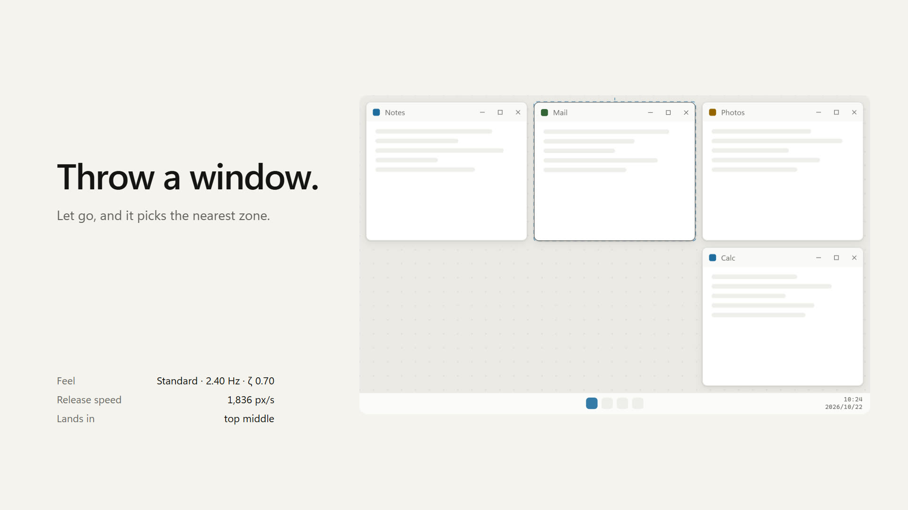
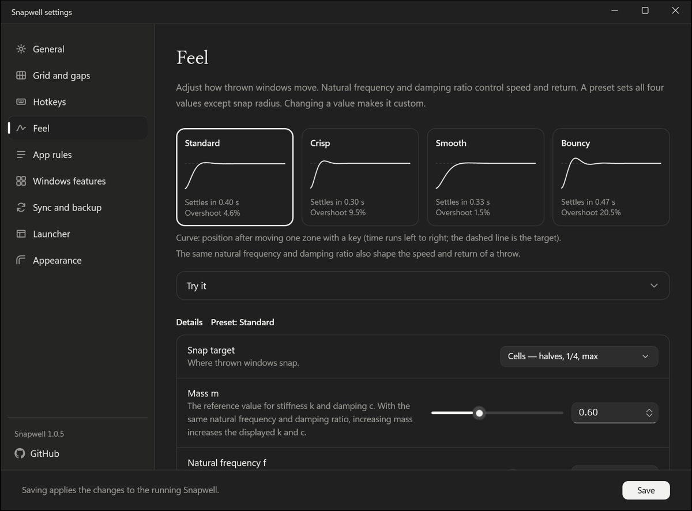
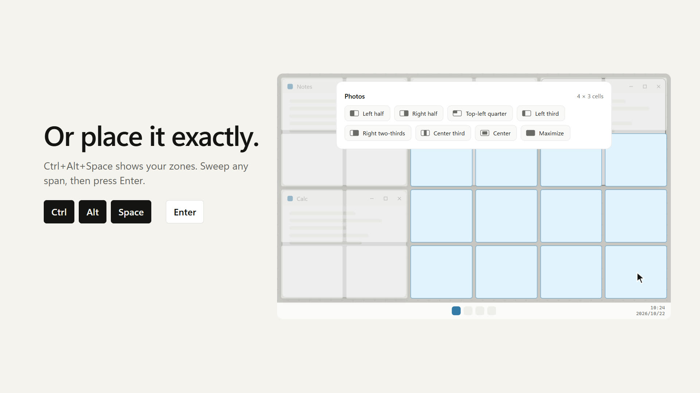
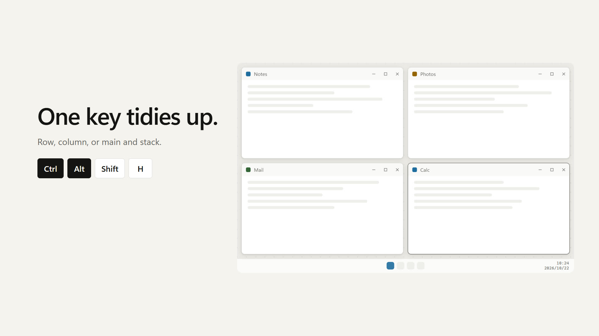
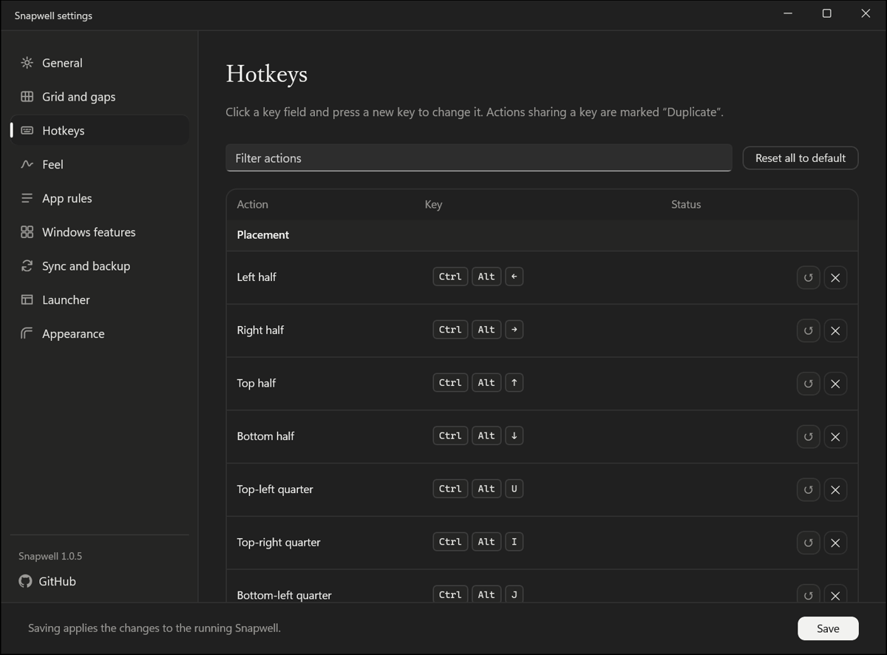

<p align="center">
  
</p>

<h1 align="center">Snapwell</h1>

<p align="center">
  <a href="README.md">English</a> | <a href="README.ja.md">日本語</a> | <a href="README.zh-Hans.md">简体中文</a> | <strong>繁體中文</strong>
</p>

Snapwell 是一款適用於 Windows 11 的視窗管理員。把視窗甩出去，彈簧與磁鐵會把它吸向網格中最近的格。

[](https://tabunugoku.github.io/Snapwell/)

影片配有音效與音樂。它不是應用程式的螢幕錄影，而是以與 Snapwell 相同的物理模型驅動的介面模型（mockup）。在[首頁](https://tabunugoku.github.io/Snapwell/)上，您可以親自甩一甩視窗。

## 特色

- 將螢幕劃分為 8 × 8 等網格，以整格為單位放置視窗並調整大小。
- 以像素為單位設定視窗之間的間距與螢幕邊緣的邊距。間距為 0 時，視窗會緊鄰排列。
- 根據放開時的速度預測視窗會停在哪裡，再藉由彈簧、磁鐵與牆壁，把視窗送到某一格或螢幕四角。
- 可透過快速鍵、啟動器與系統匣功能表操作。
- 提供 x64 與 ARM64 原生版本，沒有 x86 版本。
- 網路存取僅限於選用的更新檢查，以及您按一下「更新並重新啟動」時下載發行套件（以更新簽章驗證）。不會對其他應用程式注入 DLL。

## 功能詳解

### 甩出即吸附

抓住標題列後放開。Snapwell 會根據放開瞬間的速度預測視窗會停在哪裡，並把它送到最近的格。吸附目標可以選擇格或四角，也可以顯示預測線與「目標區域預覽」（視窗將落入的格）。

運動由質量、剛性與阻尼計算得出，沒有固定的時間長度或緩動曲線。在設定視窗的「手感」頁面中，可以從 4 個預設中選擇，也可以自行設定各項數值。



### 網格與間距

可以為每台顯示器分別選擇網格，例如 8 × 8、12 × 6 或 6 × 4。視窗間距與螢幕邊緣的邊距都可以在 0 到 200 px 之間設定。

可以用快速鍵將前景視窗每次放大或縮小一格。另有一個選項：手動調整大小後放開時，視窗會對齊到最近的格邊界。

「置中」預設與 Ctrl+Alt+C 會左右、上下對稱地使用最靠近螢幕中央的格。對於 12 × 12 這類無法恰好對準中央的網格也同樣適用。

### 啟動器

按 Ctrl+Alt+Space 開啟啟動器。目標視窗所在的顯示器上會疊加出網格，視窗會貼合您拖曳選取的格範圍。也可以使用預設，例如二分之一、四分之一、三分之一、三分之二、置中與最大化等。

在啟動器中還可以最多選取 9 個視窗，一併排列。

[](https://tabunugoku.github.io/Snapwell/)

### 排列

Snapwell 提供 4 種排列方式。

- 網格
- 水平並排
- 垂直堆疊
- 主視窗與堆疊（前景視窗佔左半邊，其餘視窗垂直堆疊在右半邊）

排列對象可以是目前的顯示器、所有顯示器，或在啟動器中選取的視窗。按 Ctrl+Alt+A，可將目前顯示器上的視窗依網格排列。

[](https://tabunugoku.github.io/Snapwell/)

### 靠向相鄰視窗、在顯示器之間移動

按 Ctrl+Alt+Shift+J、L、I、K，前景視窗會靠向其左側、右側、上方或下方相鄰視窗的邊緣，並保留您設定的間距。按 Ctrl+Alt+PageUp 與 PageDown，可把視窗甩到相鄰的顯示器。

### 快速鍵

所有快速鍵都可以在設定視窗的「快速鍵」頁面中變更。主要的預設按鍵如下。

| 動作 | 預設按鍵 |
|---|---|
| 開啟啟動器 | Ctrl+Alt+Space |
| 左、右、上、下半邊 | Ctrl+Alt+←、→、↑、↓ |
| 四分之一（左上、右上、左下、右下） | Ctrl+Alt+U、I、J、K |
| 最大化 | Ctrl+Alt+Enter |
| 置中 | Ctrl+Alt+C |
| 每次放大或縮小一格 | Ctrl+Alt+Shift+方向鍵 |
| 靠向相鄰視窗的邊緣（左、右、上、下） | Ctrl+Alt+Shift+J、L、I、K |
| 排列目前的顯示器（網格） | Ctrl+Alt+A |
| 水平並排、垂直堆疊、主視窗與堆疊 | Ctrl+Alt+Shift+H、V、M |
| 排列所有顯示器 | Ctrl+Alt+Shift+A |
| 甩到下一個顯示器 | Ctrl+Alt+PageUp、PageDown |
| 暫停／繼續 | Ctrl+Alt+Pause |



### 應用程式規則

對於特定應用程式的視窗，可以將其排除在 Snapwell 之外、只移動位置，或變更圓角的處理方式。這些規則適用於整體設定難以處理的視窗，例如快顯視窗、遊戲啟動器與子母畫面。

### Windows 內建的貼齊

Windows 內建的貼齊與貼齊版面配置會與 Snapwell 的視窗移動相互衝突，因此可以在設定視窗中關閉內建貼齊。另一個選項可將 Win + 方向鍵取代為左、右、上、下半邊。

只有在您同意並在設定視窗中開啟後，Snapwell 才會變更 Windows 設定。變更前的原始值會儲存在另一個檔案中，並在您關閉該選項時、Snapwell 結束時，以及當機後下次啟動時還原。設定視窗中的「還原 Windows 行為」按鈕也能達到同樣的效果。

「登入時啟動」同樣在您開啟之前不會註冊，關閉後會移除註冊。

### 其他

- 設定是一個 JSON 檔案，可以透過您自選的同步資料夾（例如 OneDrive 或 Dropbox 資料夾）在多台電腦間共用。同步不由 Snapwell 完成，它只是讀寫該資料夾中的檔案。
- 支援匯入與匯出設定。
- 介面語言有日文、英文與中文（簡體、繁體）。中文自 1.0.6 起提供。預設會依照 Windows 的顯示語言。設定視窗、系統匣功能表與啟動器會依照 Windows 的淺色或深色主題。
- 首次啟動時會開啟設定視窗中的初始設定：先播放一段簡短的開場動畫，再進入可以甩視窗試玩的歡迎畫面，然後依序決定 Windows 功能、快速鍵與網格。按一下滑鼠或按 Esc 可略過開場動畫。當 Windows 的動畫效果關閉，或 Snapwell 的「減少動畫」選項開啟時，會自動略過。
- 「手感」頁面提供「減少動畫」選項。開啟它，或 Windows 的動畫效果處於關閉狀態時，視窗會不帶動畫地直接移到目標位置。
- 預設不檢查更新。只有在您開啟「自動檢查更新」，或按一下「立即檢查」時，才會向 GitHub Releases 查詢新版本。在通知中按一下「更新並重新啟動」後，會下載發行套件、以更新簽章驗證、取代檔案並啟動新版本。在您按一下之前不會下載任何內容；如果無法確認新版本能正常啟動，Snapwell 會還原為之前的版本。
- 如果您開啟了「以系統管理員身分啟動」，更新後的第一次啟動不會以系統管理員身分執行。從下次登入起，或結束 Snapwell 後重新啟動時，才會以系統管理員身分執行。

## 系統需求

- Windows 11（x64 或 ARM64）
- 沒有安裝程式。這是解壓縮 zip 後即可使用的可攜式版本。

## 下載與執行

1. 從 [Releases](https://github.com/tabunugoku/Snapwell/releases) 下載與您的電腦相符的 zip：`Snapwell-<版本>-win-x64.zip` 或 `Snapwell-<版本>-win-arm64.zip`。
2. 將 zip 的檢查碼與旁邊的 `.sha256` 檔案核對。在 PowerShell 中執行 `Get-FileHash <zip 的路徑> -Algorithm SHA256`。
3. 將 zip 解壓縮到任意位置，執行 `Snapwell.exe`。系統匣中會出現圖示。

目前發行的版本未經程式碼簽署，因此 Windows SmartScreen 可能會顯示警告。核對檢查碼後，請選擇「其他資訊」，然後選擇「仍要執行」。關於簽署，請參閱下文的 Code signing policy。

## 從原始碼建置

需要：

- Windows 11
- .NET SDK 9.0.300 或更新版本（在 `global.json` 中指定）
- 若要進行 NativeAOT 發佈，需要 Visual Studio 的 C++ 工具（x64 與 ARM64 都要）

還原整個方案、執行測試並檢查格式：

```powershell
dotnet restore Snapwell.sln
dotnet test --no-restore
dotnet format --verify-no-changes --no-restore
```

要發行的成品依 RID（`win-x64` 或 `win-arm64`）發佈，應用程式與設定視窗會放入同一個資料夾。方案無法帶 RID 建置，因此請依專案分別執行：

```powershell
$rid = 'win-x64'   # ARM64 請用 win-arm64
dotnet publish src/Snapwell.App/Snapwell.App.csproj -c Release -r $rid --no-restore -o out/$rid
dotnet publish src/Snapwell.Settings/Snapwell.Settings.csproj -c Release -r $rid --no-restore -o out/$rid
```

`out/<rid>/` 中的 `Snapwell.exe` 是應用程式本體，`Snapwell.Settings.exe` 會放在同一個資料夾。Git Bash 可能找不到 Visual Studio 的工具，請在 PowerShell 中執行這些命令。

推送以 `v` 開頭的標籤後，GitHub Actions 上的 `release.yml` 工作流程會為兩個 RID 建置 zip 與 SHA-256 檔案，並附加到草稿發行版本中。

影片在 `tools/film/` 中製作，製作方法見 [docs/RELEASE.md](docs/RELEASE.md)。

## 專案結構

| 資料夾 | 內容 |
|---|---|
| `src/Snapwell.Core/` | 物理模型、網格與間距的計算、排列、設定模型。不依賴 Win32。 |
| `src/Snapwell.Platform/` | Win32 層：攔截程序（hook）、視窗移動、顯示器、DWM、對 Windows 內建貼齊的控制。 |
| `src/Snapwell.App/` | 常駐系統匣的應用程式本體、覆疊層與啟動器。 |
| `src/Snapwell.Settings/` | 設定視窗（WinUI 3）。 |
| `tests/` | xUnit 單元測試。 |
| `docs/` | 設計、介面模型（mockup）以及需要在實機上檢查的事項。 |
| `site/` | 首頁（GitHub Pages）。 |

設計見 [docs/DESIGN.md](docs/DESIGN.md)，介面模型是 [docs/mockups/snapwell.html](docs/mockups/snapwell.html)。發行步驟見 [docs/RELEASE.md](docs/RELEASE.md)，實機檢查見 [docs/MANUAL_TEST.md](docs/MANUAL_TEST.md)。

## Code signing policy

Free code signing provided by [SignPath.io](https://about.signpath.io/), certificate by [SignPath Foundation](https://signpath.org/).

本政策是為向 SignPath Foundation 申請免費程式碼簽署而撰寫的。在申請獲准之前，我們散發的版本不帶簽章。從獲准後的第一個版本起，我們將依以下政策簽署。Snapwell 在更新前檢查的更新簽章，與此處的程式碼簽署是兩套不同的機制。

- 我們簽署的是放入發行 zip 的 `Snapwell.exe` 與 `Snapwell.Settings.exe`。Microsoft 等第三方元件不會重新簽署。
- 只有由 GitHub Actions 上的 `release.yml` 工作流程，根據本存放庫帶標籤的提交所建置的版本才會簽署。在本機建置的版本絕不簽署。
- 每次發行，都由核准者手動核准簽署要求。
- 所有已簽署檔案的中繼資料中，產品名稱與版本保持一致。
- 角色如下。目前只有一位維護者，兼任所有角色。

| 角色 | 負責人 |
|---|---|
| 提交者與審查者 | [tabunugoku](https://github.com/tabunugoku) |
| 核准者 | [tabunugoku](https://github.com/tabunugoku) |

- 對存放庫的變更，由維護者審查後再合併。與簽署相關的 GitHub 與 SignPath 帳戶均使用多重要素驗證加以保護。
- 如發現未簽署的版本或簽署問題，請在 [Issues](https://github.com/tabunugoku/Snapwell/issues) 中回報。

## 隱私權政策

This program will not transfer any information to other networked systems unless specifically requested by the user or the person installing or operating it.

Snapwell 預設不建立任何網路連線。它不做分析或追蹤，沒有帳戶，也不會自動傳送其他任何內容。只有在您開啟「自動檢查更新」，或按一下「立即檢查」時，它才會向 GitHub Releases 傳送 GET 要求以取得更新資訊。傳送的只有 GET 要求與 User-Agent 標頭（`Snapwell/<版本>`），不含識別碼或使用資料（GitHub 能看到您的 IP 位址）。只有在您按一下「更新並重新啟動」時，Snapwell 才會從 GitHub 下載發行套件（僅有 GET 與 User-Agent），並以更新簽章驗證。設定僅儲存在這台電腦上的以下資料夾中：

- `%APPDATA%\Snapwell\`（設定）
- `%LOCALAPPDATA%\Snapwell\`（這台電腦的狀態，以及已儲存的 Windows 設定原始值）

若要同步設定，需由您選擇同步資料夾。Snapwell 只讀寫該資料夾中的檔案。把檔案傳送到雲端的，是您所選的服務，例如 OneDrive 或 Dropbox。

## 授權條款

Snapwell 以 [MIT 授權條款](LICENSE)發行。運動的物理模型移植自 [feel](https://github.com/diip3sh/feel)（MIT）的演算法。著作權聲明見 [THIRD_PARTY_NOTICES.md](THIRD_PARTY_NOTICES.md)。
